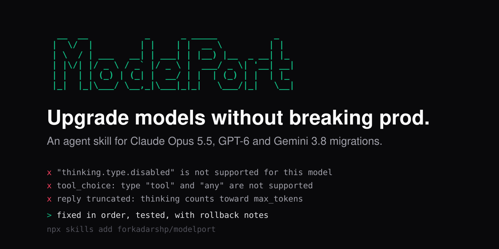

# ModelPort

[](https://github.com/forkadarshp/MPort/actions/workflows/ci.yml)
[](LICENSE)
[](SKILL.md)
[](references/models/INDEX.md)
[](CONTRIBUTING.md)



**Upgrade to Claude Opus 5.5, GPT-6, or Gemini 3.8 without breaking prod.**

ModelPort is an agent skill for Claude Code, Codex, and Cursor. It migrates the
prompts, tool definitions, API calls, and tests around a model swap, using
per-model guides that track each provider's breaking changes. Then it proves the
upgrade worked with tests, a live smoke check, and optional old-vs-new evals.

> **Install:** `npx skills add forkadarshp/MPort`, then tell your agent
> *"migrate this repo to claude-opus-5-5"*. See [Quickstart](#quickstart).

## Seen one of these after a model swap?

```text
"thinking.type.disabled" is not supported for this model.
tool_choice: type "tool" and "any" are not supported for this model.
'claude-opus-5-5' does not support tool types: computer_20251124.
temperature / top_p / logprobs rejected after moving to GPT-6
thinking_budget and thinking_level in the same request (Gemini 3.x) → 400
stop_reason: "refusal" and code that reads content[0]
```

Changing the model ID is one line. The 400s, the truncated replies (thinking now
counts toward `max_tokens`), the quiet UI between tool calls, and the parsers
that stop matching are everything else. The lookup for all of them is in
[`references/breaking-changes.md`](references/breaking-changes.md). ModelPort
applies the fixes for you, in order, and shows its evidence.

## What you get

- **Current-model knowledge.** Dedicated guides for Claude Fable 5.1, Opus 5.5,
  Sonnet 5.5, Haiku 5.5, GPT-6, and Gemini 3.8 Flash. Older guides layer
  underneath for upgrades that start further back.
- **Guides that stay fresh.** Every guide has a `Last verified:` date and a
  `Source:`. A weekly job flags stale guides, and the skill re-checks the
  provider's docs before trusting an old one.
- **A migration, not a find/replace.** Scope lock, caller discovery, file
  classification, required fixes kept apart from optional tuning, then
  validation and rollback notes.
- **Proof.** Tests, a live smoke call, and an optional three-arm benchmark
  (old model, naive swap, ModelPort) with a runnable harness.

## Supported models

| Provider | Models with a dedicated guide |
| :------- | :---------------------------- |
| Anthropic | Claude Fable 5.1, Opus 5.5, Sonnet 5.5, Haiku 5.5 (legacy: Opus 4.8, Opus 4.6, Sonnet 4.5) |
| OpenAI | GPT-6 Astra, GPT-6.1 Sol, GPT-6 Sol, GPT-6 Luna (legacy: GPT-5.5) |
| Google | Gemini 3.8 Flash |
| Anything else | Generic playbook plus provider checklists, with research on the target's docs |

Registry, upgrade paths, and freshness rules: [`references/models/INDEX.md`](references/models/INDEX.md).

## Example

```text
Use $modelport-skill to migrate this codebase to claude-opus-5-5.
Apply required compatibility fixes first, keep tool + output behavior stable,
and return validation evidence plus rollback notes.
```

You get back a report with: what changed and why, required fixes versus
optional tuning, test and smoke results, risks, and how to roll back. A sample
is in [examples/example-output.md](examples/example-output.md).

## How it works

A strict, phase-gated pipeline. The skill will not edit before scope is locked
and will not claim "done" without proof.

```text
╭──────────────────────────────────────────────────────────────────────╮
│                                                                      │
│   [ old model ]  ═══>  ( ModelPort )  ═══>  [ new model ]            │
│   what you run        behavior-preserving   what you ship            │
│                                                                      │
│   » phase 0   lock scope, read current state ················· [ OK ]│
│   » phase 1   discover callers, prompts, agents, tools ······· [ OK ]│
│   » phase 2   classify every hit before editing ·············· [ OK ]│
│   » phase 3   design: required fixes vs optional tuning ······ [ OK ]│
│   » phase 4   surgical patches, no blind search/replace ······ [ OK ]│
│   » phase 5   validate: tests + live smoke + contract ········ [ OK ]│
│   » phase 6   report: proof evidence + rollback notes ········ [ OK ]│
│                                                                      │
╰──────────────────────────────────────────────────────────────────────╯
```

## Beyond the model ID

ModelPort also adjusts prompts, tool descriptions, and guardrails to match how
the target model behaves, including changes the changelog barely mentions. Two
examples from the current generation: Claude Opus 5.5 defaults to `medium`
effort, one level below Opus 5, so an untouched config quietly thinks less. And
Claude Sonnet 5.5 can read a user message that arrives right after a tool result
as a prompt injection, so mid-task user input must be delivered as a user turn.
Each guide lists these as required fixes or optional tuning, never mixed.

## Benchmark the upgrade

Opt in and ModelPort ends with measured evidence. It runs the same eval set
against three configurations so the raw model delta and the skill's value are
attributed separately:

- **Baseline**: old model, old prompts (where you started)
- **Naive swap**: new model, old prompts (what a find/replace gets you)
- **ModelPort-enhanced**: new model, enhanced system (where you land)

Sample leaderboard from the bundled **offline simulator**. The simulator models
only prompt explicitness and a per-model "literalness" knob, so these numbers
show the report format, not real model performance:

```text
╭──────────────────────┬────────────┬────────────┬────────────╮
│ metric               │ baseline   │ naive swap │ ModelPort  │
│                      │ (old/old)  │ (new/old)  │ (new/enh.) │
├──────────────────────┼────────────┼────────────┼────────────┤
│  task success        │        64% │        57% │        93% │
│  output contract     │        64% │        57% │        93% │
│  tool-call accuracy  │        64% │        57% │        93% │
│  p95 latency         │       4.1s │       2.5s │       2.5s │
│  cost / req          │    $0.0008 │    $0.0006 │    $0.0009 │
├──────────────────────┼────────────┼────────────┼────────────┤
│  composite (50/30/20)│       0.57 │       0.63 │       0.76 │
╰──────────────────────┴────────────┴────────────┴────────────╯
```

Get real numbers: `python3 harness/run.py --provider anthropic` (needs
`ANTHROPIC_API_KEY`). The harness works with current Claude models: it never
sends parameters they reject and leaves room for always-on thinking. Details in
[harness/README.md](harness/README.md) and
[references/benchmarking.md](references/benchmarking.md).

## Quickstart

Install once, use everywhere — the universal skills CLI wires ModelPort into Codex, Claude Code, Cursor, and more:

```bash
npx skills add forkadarshp/MPort
```

*Installing for every agent on your machine? Add `--agent '*'`:*

```bash
npx skills add forkadarshp/MPort --agent '*'
```

### Manual Installation (Advanced)

If you prefer to fork and modify the skill locally:

Clone:

```bash
git clone https://github.com/forkadarshp/MPort.git
cd MPort
```

Install as a local skill with a symlink (Codex example):

```bash
mkdir -p ~/.codex/skills
ln -s "$(pwd)" ~/.codex/skills/modelport-skill
```

Or copy directly:

```bash
mkdir -p ~/.codex/skills/modelport-skill
cp -R . ~/.codex/skills/modelport-skill
```

Then ask your agent:

```text
Use $modelport-skill and the starter prompt template to migrate
services/assistant from Model A to Model B. Keep tool behavior stable, separate
required fixes from optional tuning, and include validation evidence plus
rollback notes.
```

For detailed migration requests, start from
[templates/migration-starter-prompt.md](templates/migration-starter-prompt.md).

## What it migrates

| Area | Migration support |
| --- | --- |
| API callers | Model IDs, request parameters, response contracts, SDK usage |
| Prompts | System prompts, templates, output contracts, brittle prompt hacks |
| Agents | Tool policy, orchestration behavior, autonomy, handoff instructions |
| Tools | Schemas, descriptions, validation rules, guardrails |
| Config | Model registries, routers, feature flags, rollout controls |
| Tests and docs | Fixtures, assertions, examples, migration notes |
| Benchmarks | Optional pre/post stats: quality, latency, cost, contract drift |

## Built for real migrations

- Scope lock before edits to avoid accidental repo-wide churn.
- Discovery pass across API calls, prompts, agents, tools, tests, and docs.
- File classification before modification.
- Migration-pattern selection across direct swap, adapters, shadow mode, canary,
  and expand-contract changes.
- Required fixes and optional tuning reported separately.
- Explicit coordination checks for work another agent has already started.
- Validation-first completion criteria with tests, smoke checks, and rollback
  notes.

## Example migration prompts

- "Migrate all model usage in `src/agents/` from our old model config to the new
  release, keep tool behavior stable, and give me a rollback plan."
- "Upgrade this codebase from provider A to provider B and adjust prompts so
  output format remains identical."
- "Replace deprecated model parameters in our API callers and verify tests still
  pass."
- "Do a phased migration in `services/search` with side-by-side support for old
  and new models."

More examples are in [examples/example-prompts.md](examples/example-prompts.md).

## Expected output

The skill guides your agent to produce a migration report with:

- Migration summary
- Scope and files changed
- Existing work and remaining work
- Required compatibility fixes
- Prompt and agent behavior tuning
- Validation results
- Proof evidence
- Risks and follow-up recommendations
- Rollback notes
- Benchmark results (when benchmarking was requested)

See [examples/example-output.md](examples/example-output.md) for a sample report.

## Repository structure

```text
.
├── .markdownlint-cli2.yaml
├── SKILL.md
├── README.md
├── CONTRIBUTING.md
├── CODE_OF_CONDUCT.md
├── SECURITY.md
├── LICENSE
├── assets/
│   └── social-preview.svg
├── scripts/
│   ├── validate_skill.py
│   └── check_freshness.py
├── harness/                  (offline + live old-vs-new benchmark)
├── templates/
│   └── migration-starter-prompt.md
├── references/
│   ├── benchmarking.md
│   ├── breaking-changes.md
│   ├── migration-patterns.md
│   ├── migration-playbook.md
│   ├── output-style.md
│   ├── prompt-template-research.md
│   ├── provider-checklists.md
│   ├── validation-proof.md
│   └── models/
│       ├── INDEX.md
│       ├── claude-fable-5-1.md
│       ├── claude-opus-5-5.md
│       ├── claude-sonnet-5-5.md
│       ├── claude-haiku-5-5.md
│       ├── gpt-6.md
│       ├── gemini-3-8-flash.md
│       ├── claude-opus-4-8.md      (legacy)
│       ├── claude-opus-4-6.md      (legacy)
│       ├── claude-sonnet-4-5.md    (legacy)
│       └── gpt-5-5.md              (legacy)
├── examples/
│   ├── example-prompts.md
│   └── example-output.md
├── agents/
│   └── openai.yaml
├── docs/
│   └── PUBLISHING.md
└── .github/
    ├── ISSUE_TEMPLATE/
    ├── pull_request_template.md
    └── workflows/
        ├── ci.yml
        └── freshness.yml
```

## Validate locally

```bash
python3 scripts/validate_skill.py .
npx markdownlint-cli2 "**/*.md"
```

## Open-source readiness

- MIT license included.
- CI validates Markdown and skill structure.
- Issue templates cover bugs, features, and migration case studies.
- PR template asks contributors to classify migration relevance.
- Security reporting process included via GitHub Security Advisories.
- Skill UI metadata included in `agents/openai.yaml`.

## Roadmap

- Per-model migration guides for Claude Fable 5.1 / Opus 5.5 / Sonnet 5.5 /
  Haiku 5.5, GPT-6, and Gemini 3.8 Flash ship today in `references/models/`,
  with legacy Claude and GPT-5.5 guides layered underneath. Next: Gemini Pro
  and Flash-Lite guides, and self-hosted models.
- Add regression fixtures for prompt, tool, and structured-output migrations.
- Ship a runnable benchmark harness to auto-collect the three-arm leaderboard
  (the methodology lands today in `references/benchmarking.md`).
- Add real-world before/after migration case studies.

## FAQ

### How do I migrate to Claude Opus 5.5?

Install ModelPort, then ask your agent: *"migrate this repo to
`claude-opus-5-5`."* It reads the
[Opus 5.5 guide](references/models/claude-opus-5-5.md), applies the required
compatibility fixes, preserves tool calling and output contracts, and returns
validation evidence plus rollback notes.

### How do I migrate from an older Opus (4.x) to the latest?

Upgrades layer. From 4.7 or older, ModelPort applies the
[Opus 4.8 guide](references/models/claude-opus-4-8.md) first (sampling params,
adaptive thinking, tokenizer, removed prefills), then the Opus 5.5 changes
(thinking always on, forced `tool_choice` removed, preserved thinking, computer
toolset), and re-baselines `effort`, whose default is now `medium`.

### Will changing the model ID break my tool calling or output format?

Often, yes — and that's the problem ModelPort exists to solve. Newer models
follow instructions more literally and re-tokenize differently, so a raw
find/replace can silently break tool calls and parsers. ModelPort goes beyond
the model ID: it updates prompts, tool descriptions, and guardrails to match the
target model's actual behavior — researched from observed runs, web research,
and provider changelogs, including unadvertised quirks — then validates the
contract before finishing.

### How do I benchmark a new model against my current one?

Opt into benchmarking at the start and ModelPort runs a three-arm comparison —
baseline, naive swap, and the enhanced system — on the same eval set, then
reports a leaderboard with quality, latency, cost, and contract metrics. See
[references/benchmarking.md](references/benchmarking.md).

### Does it work with Claude Code, Codex, and Cursor?

Yes. It's a universal agent skill — install it once and invoke it from Claude
Code, Codex, Cursor, or any compatible agent.

### Which models and providers does it support?

Any model or provider swap (Anthropic, OpenAI, Google, and others). It ships dedicated
migration guides for Claude Fable 5.1, Opus 5.5, Sonnet 5.5, and Haiku 5.5,
GPT-6, and Gemini 3.8 Flash (plus legacy Claude and GPT-5.5 guides), and a
generic playbook for everything else.

## Contributing

See [CONTRIBUTING.md](CONTRIBUTING.md).

## Security

See [SECURITY.md](SECURITY.md).

## License

MIT - see [LICENSE](LICENSE).
